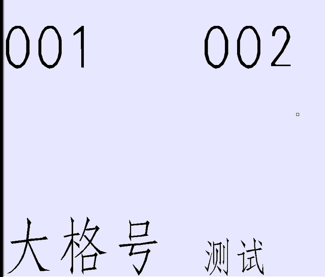
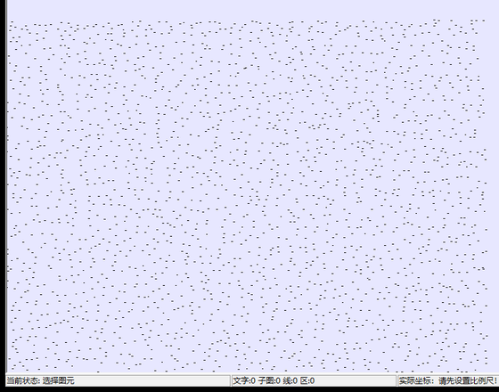

# 验收：手工生成的 .WT 能不能在 MAPGIS 里正常显示？

> 日期：2026-11-26 · 环境：Windows 11 + MAPGIS 6.7（`C:\mapgis67`）· 工具：SECTION V5.6、编辑子系统
> 触发背景：`docs/binary-format.md` 早期版本断言"手工拼装一律被拒绝"，而 `skills/vector-io` 的写库却能生成文件。
> 本页是**据此做的实测验收**，结论用于收回/确认该断言。

## 一、结论

**能显示，而且文字、字号、颜色、符号都正确。**

早期那批文件被拒的根因不是"手工生成"，而是**缺段**：属性段与两个附属表段的指针被清空。
只要 657 B 头从真实文件克隆、5 个索引段（点）/8 个索引段（线）齐全，MAPGIS 6.7 正常加载并渲染。

## 二、验收项与结果

| # | 检查项 | 结论 | 证据 |
|---|---|---|---|
| 1 | 生成的点文件能否被 MAPGIS **加载** | ✅ 编辑子系统标题栏变为 `MAPGIS 编辑子系统 - 大格编号.WT`，左栏"文件列表"出现该层 | 打开即见 |
| 2 | 点符号是否正确 | ✅ **子图号 48 = 实心圆** |  左：1 号＝怪符号；右：48 号＝实心圆 |
| 3 | 符号尺寸是否可控 | ✅ 8 / 4 / 2 mm 三档直径成比例 |  |
| 4 | 注记文字（数字） | ✅ "001""002" 正常 |  |
| 5 | 注记文字（中文） | ✅ "大格号""测试" 正常 → **GBK 文本池 + 1602 B 前缀正确** | 同上 |
| 6 | 字号是否可控 | ✅ 6 mm 与 4 mm 明显不同 | 同上 |
| 7 | 锚点/位置 | ✅ 文字都在锚点右上方，间距与坐标差（20 mm）一致 | 同上 |
| 8 | 492 个大格编号 | ✅ 呈 26×19 网格，位置与格心吻合 | `output_labels/大格编号.WT` |
| 9 | 2189 个采样点整层 | ✅ 全图水系状分布，无缺块 |  |

## 三、两个容易误判的现象

1. **打开后图面空白、标尺 0–900** —— 不是文件坏了，是**没复位窗口**。
   拿真实的 `图框.WT` 打开也是同样空白。用 Section 打开会自动 fit，MAPGIS 编辑里要手动"复位窗口"。
2. **子图号 1 是个怪符号** —— 本机 Slib 里 1 号不是圆点；`48` 才是实心圆。换机器前先试 48。

## 四、复现步骤

```bat
REM 1) 生成验收用文件（大字注记 + 三种字号符号）
python skills\vector-io\scripts\demo_selftest.py out\     REM 结构自检，5 项断言
python work\make_big_labels.py                               REM 或自写几行 write_wt_annot

REM 2) 用 Section 打开（自动复位视图）
"C:\mapgis67\program\section.exe" out\TEST_BIG.WT
```

```python
from mapgis_wl import write_wt_annot
write_wt_annot("TEST_BIG.WT", [
    dict(x=10500, y=57000, text="001", h=6, w=5, gap=0.5, color=1),
    dict(x=10520, y=57000, text="大格号", h=6, w=5, gap=0.5, color=1),
], template=r"...\图框.WT")     # 模板必须给，且必须是 .WT
```

## 五、对仓库结论的修订

| 位置 | 原文 | 现在 |
|---|---|---|
| `docs/binary-format.md` | "手工生成文件一律不被识别……不要试图手工拼装" | 改为"**缺段**才不被识别；补齐 5/8 段并克隆头即可（本节已实测）" |
| `skills/vector-io/SKILL.md` | "最终显示仍需在 MAPGIS 里目视确认一次（尚未做）" | 改为"已验证，见 `docs/verification.md`；换机器/Slib 版本仍需再确认" |

## 六、边界（仍然成立）

- 本次验收只覆盖 **点文件与注记**；线文件的显示与面文件的渲染**尚未逐项目视验收**（结构自检通过）。
- 换 Slib / 换机器后符号编号可能不同，需重新确认一次。
- 大字号（≥4 mm）肉眼即可判读；2 mm 常规点位图字号在整幅缩放下只能看出"有点"，要看清文字必须放大。
